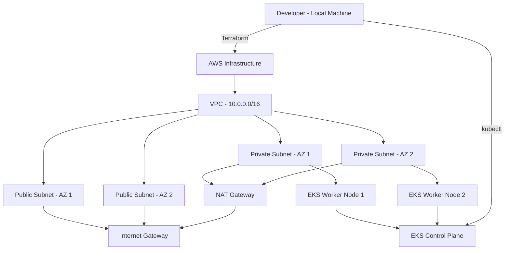

# 🚀 Amazon EKS Cluster Provisioning using Terraform

## 📌 Project Overview

This project demonstrates the provisioning of an Amazon Elastic Kubernetes Service (EKS) cluster using Terraform. The infrastructure is provisioned on AWS using Infrastructure as Code (IaC), including a custom VPC, public and private subnets, Internet Gateway, NAT Gateway, route tables, security groups, IAM roles, an EKS control plane, and an EKS managed node group.

The cluster is deployed across two Availability Zones to provide a distributed worker-node setup. The worker nodes are deployed in private subnets, while public subnets are used for internet-facing infrastructure and network connectivity.

The entire infrastructure is provisioned and managed using Terraform.

## 🏗️ Architecture



## ⚙️ Infrastructure Components

| Component | Configuration |
|---|---|
| Cloud Provider | AWS |
| Infrastructure as Code | Terraform |
| Kubernetes Service | Amazon EKS |
| Region | US East - N. Virginia (`us-east-1`) |
| VPC CIDR | `10.0.0.0/16` |
| Public Subnets | `10.0.4.0/24`, `10.0.5.0/24` |
| Private Subnets | `10.0.1.0/24`, `10.0.2.0/24` |
| Availability Zones | 2 |
| Worker Nodes | 2 |
| Instance Type | `t3.medium` |
| Node Group | EKS Managed Node Group |
| NAT Gateway | Single NAT Gateway |
| Container Orchestration | Kubernetes |
| Authentication | AWS IAM / EKS Access Entries |

## 🛠️ Technologies Used

- **Terraform** – Infrastructure provisioning and management.
- **Amazon EKS** – Managed Kubernetes control plane.
- **Amazon VPC** – Network isolation and infrastructure networking.
- **EC2** – Kubernetes worker nodes.
- **IAM** – Identity and access management.
- **Security Groups** – Network traffic control.
- **Internet Gateway** – Internet connectivity for public subnet resources.
- **NAT Gateway** – Outbound internet connectivity for resources in private subnets.
- **AWS CLI** – AWS authentication and EKS configuration.
- **kubectl** – Kubernetes cluster management.

## 📐 AWS Network Architecture

### VPC

A custom VPC was created with the CIDR block:

`10.0.0.0/16`

The VPC provides an isolated network environment for the EKS cluster and its associated AWS resources.

### Subnets

The VPC contains four subnets distributed across two Availability Zones.

| Subnet | CIDR | Type |
|---|---|---|
| Subnet 1 | `10.0.1.0/24` | Private |
| Subnet 2 | `10.0.2.0/24` | Private |
| Subnet 3 | `10.0.4.0/24` | Public |
| Subnet 4 | `10.0.5.0/24` | Public |

The EKS worker nodes are deployed inside the private subnets to avoid direct public internet exposure.

### Internet Gateway

An Internet Gateway was attached to the VPC to provide internet connectivity to resources in the public subnets through the public route table.

### NAT Gateway

A single NAT Gateway was configured in a public subnet.

It allows instances deployed in private subnets to initiate outbound internet connections while keeping them inaccessible through direct internet-initiated connections.

For this project, a single NAT Gateway was used to reduce infrastructure costs.

### Route Tables

Separate route tables were configured for public and private subnet networking.

- **Public route table:** Routes internet-bound traffic through the Internet Gateway.
- **Private route table:** Routes outbound internet traffic through the NAT Gateway.

### Security Groups

Security groups were configured to control network traffic between AWS resources and the EKS cluster components.

Security groups provide network-level access control by defining inbound and outbound traffic rules.

## ☸️ Amazon EKS Configuration

Amazon EKS was provisioned using the Terraform EKS module.

The cluster consists of:

- Managed Kubernetes control plane.
- EKS managed node group.
- Two EC2 worker nodes.
- IAM roles and policies.
- IAM integration for cluster access.
- Private subnet deployment for worker nodes.

### EKS Managed Node Group

The managed node group was configured with the following settings:

| Setting | Value |
|---|---|
| Node Group Name | `node_group` |
| Instance Type | `t3.medium` |
| Minimum Nodes | 2 |
| Desired Nodes | 2 |
| Maximum Nodes | 6 |
| Capacity Type | On-Demand |
| Subnets | Private Subnets |

The node group is managed by Amazon EKS, which handles the integration and lifecycle management of the worker nodes.

## 🔐 IAM and Cluster Access

IAM was used to configure permissions and identities required for the EKS cluster and worker nodes.

An EKS Access Entry and an associated EKS access policy were configured to allow the AWS identity to access and manage Kubernetes resources.

The local machine uses AWS CLI authentication and `kubectl` to communicate with the EKS API Server.

## 📁 Project Structure

```text
terraform-eks/
│
├── main.tf
├── variables.tf
├── versions.tf
├── outputs.tf
├── terraform.tfvars
├── .gitignore
│
└── README.md
```

*The exact file structure may vary depending on the Terraform configuration.*

## 🚀 Deployment Steps

### 1. Prerequisites

Install the following tools:

- [Terraform](https://developer.hashicorp.com/terraform/install)
- [AWS CLI](https://docs.aws.amazon.com/cli/latest/userguide/getting-started-install.html)
- [kubectl](https://kubernetes.io/docs/tasks/tools/)

Verify the installations:

```bash
terraform version
aws --version
kubectl version --client
```

### 2. Configure AWS CLI

Configure your AWS credentials:

```bash
aws configure
```

Provide the AWS access credentials, region, and output format.

Set the region to:

```text
us-east-1
```

Verify your AWS identity:

```bash
aws sts get-caller-identity
```

### 3. Clone the Repository

```bash
git clone https://github.com/YOUR_USERNAME/terraform-eks.git
```

Navigate to the project directory:

```bash
cd terraform-eks
```

### 4. Initialize Terraform

Initialize the Terraform working directory and download the required providers and modules:

```bash
terraform init
```

### 5. Validate Terraform Configuration

```bash
terraform validate
```

### 6. Review the Infrastructure Plan

```bash
terraform plan
```

Review the resources Terraform intends to create before proceeding.

### 7. Provision the Infrastructure

```bash
terraform apply
```

Review the plan and type:

```text
yes
```

Terraform will provision the AWS infrastructure, including the VPC, subnets, networking resources, security groups, IAM resources, EKS cluster and managed node group.

### 8. Connect to the EKS Cluster

After the cluster has been created, configure your local kubeconfig.

```bash
aws eks update-kubeconfig --region us-east-1 --name <your-cluster-name>
```

Replace `<your-cluster-name>` with the actual EKS cluster name.

This command updates the local kubeconfig file and configures kubectl to connect to the EKS cluster.

### 9. Verify the Cluster Connection

Check the cluster information:

```bash
kubectl cluster-info
```

Check the worker nodes:

```bash
kubectl get nodes
```

Expected output:

```text
NAME                           STATUS   ROLES    AGE   VERSION
ip-10-0-1-54.ec2.internal      Ready    <none>   ...   ...
ip-10-0-2-70.ec2.internal      Ready    <none>   ...   ...
```

### 10. Explore Kubernetes Resources

View all Pods across namespaces:

```bash
kubectl get pods -A
```

View namespaces:

```bash
kubectl get namespaces
```

View deployments:

```bash
kubectl get deployments -A
```

View services:

```bash
kubectl get services -A
```

Inspect node details:

```bash
kubectl describe nodes
```

## 🧹 Destroy Infrastructure

To avoid unnecessary AWS charges, destroy the infrastructure when it is no longer required.

```bash
terraform destroy
```

Review the destruction plan and confirm when prompted.

**Note:** This will delete the Terraform-managed infrastructure, including the EKS cluster, worker nodes, and associated networking resources.

## 💡 Key Learnings

- Provisioning AWS infrastructure using Terraform.
- Building a custom VPC architecture.
- Working with public and private subnets across Availability Zones.
- Understanding Internet Gateway and NAT Gateway.
- Configuring AWS route tables and subnet associations.
- Understanding AWS security groups.
- Provisioning an Amazon EKS cluster using Terraform.
- Configuring EKS managed node groups.
- Understanding IAM integration with EKS.
- Connecting a local machine to an EKS cluster using AWS CLI and kubectl.
- Verifying Kubernetes nodes and cluster resources.
- Managing infrastructure lifecycle using Terraform.

## ⚠️ Cost Considerations

AWS resources created by this project may incur charges, including:

- Amazon EKS cluster.
- EC2 worker nodes.
- NAT Gateway.
- EBS storage.
- Public IPv4 addresses and associated networking resources.

Destroy the infrastructure when it is no longer required.

---

**Built using Terraform and AWS | Infrastructure as Code | Amazon EKS | Kubernetes**
